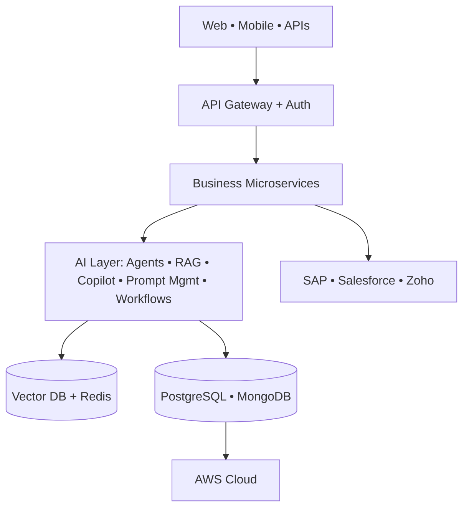

<!-- SHAILESH KUMAR KHANCHANDANI | Enterprise AI Leader -->

 

  

---

## 👋 About Me

I design, deliver and scale **enterprise-grade AI ecosystems** that solve real business problems. Over **12+ years** I have led software engineering, digital transformation and AI product delivery across Manufacturing, Automotive, Education, Finance and Enterprise SaaS, with a focus on **LLMs, RAG, agentic workflows and multi-agent systems** for the last **4+ years**.

> *Technology creates value only when it empowers people, simplifies complexity, and transforms businesses at scale.*

| 🗓 Experience | 🤖 Enterprise AI | 📦 Projects | 👥 Teams Led | 🌐 Industries |
|:---:|:---:|:---:|:---:|:---:|
| **12+ Years** | **4+ Years** | **50+** | **40+ Engineers** | **6+** |

---

## 🏢 Experience

| Period | Role | Company | Focus |
|---|---|---|---|
| **Aug 2025 – Present** | AI Product & Delivery Manager | **Vishleshan Software Solutions** | Enterprise AI products, workflow automation, roadmaps for manufacturing & automotive clients |
| **Sep 2024 – Jul 2025** | Senior Project Manager | **Edulab Edutech** | University ERP, LMS, CET registration, biometric attendance, WhatsApp communication |
| **Jul 2021 – Jul 2024** | Senior Associate Project Manager | **CHIRPN IT Solutions** | AutoCar AI, Sportly, Salesforce integrations, Agile delivery |

<b>Earlier roles</b>

- **Technical Lead**, Utkarsh Classes: learning platforms, AWS media streaming
- **Buyer Coordination & E-Commerce**: digital commerce, SEO, inventory operations
- **Business Development & Technical Support**: CRM operations, customer success
- **Senior Data Analyst**: global reporting and research analytics

**Clients:** Kajaria Ceramics • Tata Motors • Luminous • Polycab • Multiple Universities

---

## 🚀 Featured Platforms

<b>🏢 Kajaria One — Enterprise Sales & Distribution Platform</b>

Multi-tenant field-sales ecosystem for dealer operations, lead management, orders, SAP sync, GPS attendance and executive dashboards.

**Modules:** Dealer Management • Sales Executive App • Lead & Opportunity Pipeline • Orders & Quotations • GPS Attendance • PJP Planning • Approval Workflow • Dashboards

`Java` `Spring Boot` `Next.js` `React` `SAP CPI` `PostgreSQL` `Redis` `AWS`

<b>🚗 Agentic Finance & Insurance Automation</b>

Multi-agent platform for lead routing, workflow orchestration and decision automation. **65% faster lead processing.**

`Java` `Angular` `AI Agents` `REST APIs`

<b>🧠 Enterprise AI RAG Platform</b>

Natural-language search over enterprise knowledge with semantic search, knowledge graph, document intelligence and a citation engine.

`Python` `FastAPI` `LangChain` `LlamaIndex` `Vector DB` `OpenAI`

<b>💬 WhatsApp AI Assistant</b>

LLM-powered conversational assistant: memory-aware chat, CRM integration, workflow execution and human escalation.

`Gemini` `LangChain` `Python` `Twilio` `Vector DB`

<b>🤖 AutoCar AI — Autonomous Software Engineering</b>

Requirements → JIRA → AI coding agents → Testing → GitHub Actions → Deployment.

`Golang` `React` `GitHub Actions` `JIRA APIs` `AI Agents`

<b>💡 Sales AI</b> • <b>🚚 Dealer Platform</b> • <b>🛒 Dealer Commerce</b>

- **Sales AI:** KPI dashboards, predictive analytics, dealer insights (`Python` `FastAPI` `React` `PostgreSQL`)
- **Dealer Platform:** ordering, inventory, procurement, mobile app (`React` `React Native` `Node.js`)
- **Dealer Commerce:** dealer portal, orders, tracking, procurement

<b>🎓 Education: University ERP • CET Registration • Biometric Attendance</b>

- **University ERP:** admissions, SIS, examination, LMS, fees, HR, payroll, AI student assistant
- **CET Registration:** state-level, high-availability application processing
- **Biometric Attendance:** device management, verification, real-time monitoring

<b>🏅 Sportly</b>

Performance analytics for international sports organizations: activity tracking, health monitoring, reporting dashboards.

---

## 🏗 Reference Architecture

---

## 🛠 Tech Stack

| Area | Technologies |
|---|---|
| **AI / GenAI** | OpenAI • Azure OpenAI • Gemini • Claude • LangChain • LangGraph • LlamaIndex • CrewAI • AutoGen • MCP • Hugging Face |
| **Data** | PostgreSQL • MySQL • MongoDB • Redis • Neo4j • Pinecone • Qdrant • ChromaDB |
| **Backend** | Spring Boot • FastAPI • Flask • Node.js • REST • GraphQL • OAuth2 • JWT |
| **Frontend** | React • Next.js • Angular • Tailwind CSS |
| **Cloud & DevOps** | AWS • GCP • Docker • Kubernetes • Terraform • Jenkins • GitHub Actions |
| **Integration** | SAP CPI • Salesforce • Zoho CRM • Kafka • RabbitMQ • Twilio • WhatsApp APIs |
| **Delivery & Design** | Jira • Confluence • Trello • MS Planner • Figma • Adobe XD |
| **AI IDEs** | Cursor • Trae • Lovable |

---

## 🎓 Academia & Research

**Guest / Visiting Faculty:** MBM University Jodhpur • HSNC University Mumbai • IAQS Institute Mumbai (AI, Computer Networks, System Design, Analytics)

📘 **Harnessing Artificial Intelligence to Ensure Diverse Global Teams**, Elsevier (ISBN `9780443341359`)
📘 **Comparative Analysis of MANET Routing Protocols Using NS-3**, IJSREM (DOI `10.55041/ijsrem30773`)
📘 **Small Language Models for Real-World AI**, research on SLMs, hybrid AI frameworks, efficient LLM deployment

**Certifications:** PMP® Training (PMI) • Google Generative AI • Gemini AI (Google Cloud) • IBM AI • Neo4j & LLM Fundamentals • LangChain & LlamaIndex (iNeuron) • Intel AI For All • AWS DevOps • Responsible AI (LinkedIn Learning)

---

## 📈 Impact at a Glance

| 📦 Projects | 🤖 AI Platforms | 🔌 APIs | 🔗 Integrations | ⚙️ AI Workflows | 🚀 Deployments | 👥 Users |
|:---:|:---:|:---:|:---:|:---:|:---:|:---:|
| **50+** | **15+** | **250+** | **30+** | **100+** | **300+** | **100K+** |

---

## 🎯 Current Focus

**Enterprise AI:** GenAI platforms • Agentic systems • Enterprise RAG • Copilots
**Engineering:** Cloud-native architecture • Event-driven design • AI integration platforms
**Research:** Small Language Models • AI governance • AI evaluation frameworks

## 🤝 Open for Collaboration

Enterprise AI & consulting • Product architecture & modernization • Guest lectures & research • Spring Boot / FastAPI / React / Next.js engineering

---

 

**Building the next generation of Enterprise AI systems, one platform at a time. 🚀**

