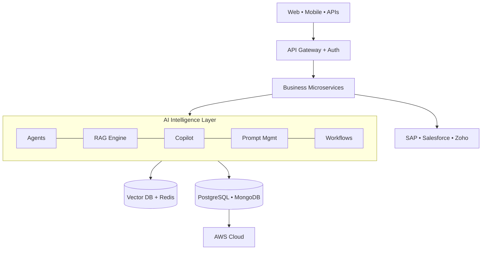

<!-- SHAILESH KUMAR KHANCHANDANI | Enterprise AI Leader | README v3 -->

# Shailesh Kumar Khanchandani

**Enterprise AI • GenAI • Product & Delivery Leadership**

  

**[About](#about) • [Impact](#impact) • [Platforms](#platforms) • [Architecture](#architecture) • [Stack](#stack) • [Career](#career) • [Research](#research) • [Contact](#contact)**

<h2 align="center"></h2>

> [!NOTE]
> **12+ years** in enterprise software, **4+ years** focused on LLM, RAG and agentic AI, delivering for Manufacturing, Automotive, Education, Finance and Enterprise SaaS.

I design, deliver and scale **enterprise-grade AI ecosystems** that solve real business problems. My work sits where **architecture, product strategy, engineering leadership and delivery** meet.

| 🏗 What I Build | 🧭 What I Lead |
|---|---|
| Enterprise AI platforms & copilots | Enterprise AI strategy |
| Agentic & multi-agent workflows | Product roadmaps & releases |
| Enterprise RAG & knowledge systems | Agile program delivery |
| Integration platforms (SAP, CRM) | Cross-functional teams (40+ engineers) |
| AI analytics & SaaS products | Stakeholder & executive reporting |

<h2 align="center"></h2>

> [!TIP]
> **Clients:** Kajaria Ceramics • Tata Motors • Luminous • Polycab • Universities

| 📦 Projects | 🤖 AI Platforms | 🔌 APIs | 🔗 Integrations | ⚙️ AI Workflows | 🚀 Deployments | 👥 Users |
|:---:|:---:|:---:|:---:|:---:|:---:|:---:|
| **50+** | **15+** | **250+** | **30+** | **100+** | **300+** | **100K+** |

<h2 align="center"></h2>

> [!IMPORTANT]
> Client work is described at a high level. Metrics are from delivered programs.

<table>
<tr>
<td width="50%" valign="top">

### 🏢 Kajaria One
**Sales & Distribution Platform**
Multi-tenant field-sales ecosystem: dealers, leads, orders, SAP sync, GPS attendance, dashboards.
 `Java` `Spring Boot` `Next.js` `SAP CPI` `PostgreSQL` `AWS`

</td>
<td width="50%" valign="top">

### 🚗 Agentic F&I Automation
**Finance & Insurance AI**
Multi-agent lead routing and workflow orchestration. **65% faster lead processing.**
 `Java` `Angular` `AI Agents`

</td>
</tr>
<tr>
<td valign="top">

### 🧠 Enterprise RAG Platform
**Knowledge Intelligence**
Natural-language enterprise search with knowledge graph and citation engine.
 `Python` `FastAPI` `LangChain` `LlamaIndex`

</td>
<td valign="top">

### 💬 WhatsApp AI Assistant
**Conversational AI**
Memory-aware chat, CRM integration, workflow execution, human escalation.
 `Gemini` `LangChain` `Twilio`

</td>
</tr>
<tr>
<td valign="top">

### 🤖 AutoCar AI
**Autonomous SDLC**
Requirements → JIRA → AI coding agents → Tests → GitHub Actions → Deploy.
 `Golang` `React` `JIRA APIs`

</td>
<td valign="top">

### 💡 Sales AI
**Sales Intelligence**
KPI dashboards, predictive analytics and dealer insights.
 `Python` `FastAPI` `React`

</td>
</tr>
</table>

<b>📂 More platforms</b>

 

| Platform | Scope |
|---|---|
| 🚚 **Dealer Platform** | Ordering, inventory, procurement, mobile app (`React` `React Native` `Node.js`) |
| 🛒 **Dealer Commerce** | Dealer portal, orders, tracking, procurement |
| 🎓 **University ERP** | Admissions, SIS, exams, LMS, fees, HR, payroll, AI assistant |
| 📝 **CET Registration** | State-level, high-availability registrations |
| 📲 **Biometric Attendance** | Device management, verification, monitoring |
| 🏅 **Sportly** | Athlete performance and health analytics |

<h2 align="center"></h2>

<h2 align="center"></h2>

<b>🤖 AI / GenAI</b>

OpenAI • Azure OpenAI • Gemini • Claude • LangChain • LangGraph • LlamaIndex • CrewAI • AutoGen • MCP • Hugging Face • Fine-tuning • Vector Search

<b>⚙️ Backend, Frontend & Data</b>

**Backend:** Spring Boot • FastAPI • Flask • Node.js • REST • GraphQL • OAuth2 • JWT
**Frontend:** React • Next.js • Angular • TypeScript • Tailwind CSS
**Data:** PostgreSQL • MySQL • SQL Server • MongoDB • Redis • Neo4j • Pinecone • Qdrant • ChromaDB

<b>☁️ Cloud, DevOps & Integration</b>

**Cloud:** AWS (EC2, ECS, ECR, RDS, S3, CloudFront) • GCP • Docker • Kubernetes • Terraform
**DevOps:** Git • GitHub Actions • Jenkins • CI/CD • DevSecOps
**Integration:** SAP CPI • Salesforce • Zoho CRM • Kafka • RabbitMQ • Twilio • WhatsApp APIs • Webhooks

<b>🧰 Delivery, Design & AI IDEs</b>

Jira • Confluence • Trello • MS Planner • Figma • Adobe XD • Cursor • Trae • Lovable

<h2 align="center"></h2>

| Period | Role | Company | Focus |
|---|---|---|---|
| **Aug 2025 – Now** | AI Product & Delivery Manager | **Vishleshan Software Solutions** | Kajaria One, Tata Motors F&I AI, RAG, WhatsApp AI, BridgeX, eDukaan |
| **Sep 2024 – Jul 2025** | Senior Project Manager | **Edulab Edutech** | University ERP, LMS, CET, biometric attendance |
| **Jul 2021 – Jul 2024** | Senior Associate Project Manager | **CHIRPN IT Solutions** | AutoCar AI, Sportly, Salesforce, Agile delivery |

<b>Earlier roles</b>

Technical Lead (Utkarsh Classes) • Buyer Coordination & E-Commerce • Business Development & Technical Support • Senior Data Analyst

<h2 align="center"></h2>

| 📘 Publication | Venue |
|---|---|
| Harnessing Artificial Intelligence to Ensure Diverse Global Teams | Elsevier, ISBN `9780443341359` |
| Comparative Analysis of MANET Routing Protocols Using NS-3 | IJSREM, DOI `10.55041/ijsrem30773` |
| Small Language Models for Real-World AI | Research on SLMs & hybrid AI |

**Faculty:** MBM University Jodhpur • HSNC University Mumbai • IAQS Institute Mumbai

<b>🏆 Certifications</b>

PMP® Training (PMI) • Google Generative AI • Gemini AI (Google Cloud) • IBM AI • Neo4j & LLM Fundamentals • LangChain & LlamaIndex (iNeuron) • Intel AI For All • AWS DevOps • Responsible AI (LinkedIn Learning)

<h2 align="center"></h2>

- [x] Enterprise GenAI platforms & agentic systems
- [x] Enterprise RAG and AI copilots
- [ ] Small Language Models, AI governance, evaluation frameworks (research)

> [!TIP]
> Open to **enterprise AI consulting**, product architecture, modernization, guest lectures and research collaboration.

<h2 align="center"></h2>

*Technology creates value only when it empowers people, simplifies complexity, and transforms businesses at scale.*

<a href="#top">⬆ back to top</a>

